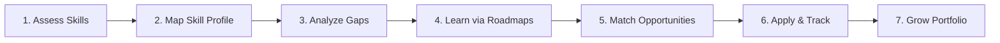
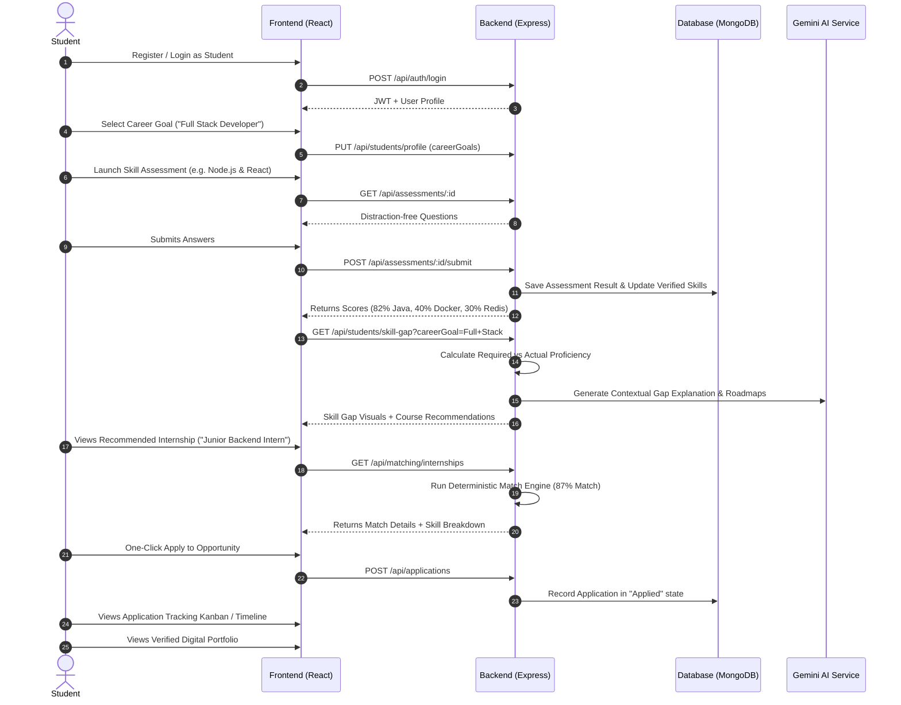
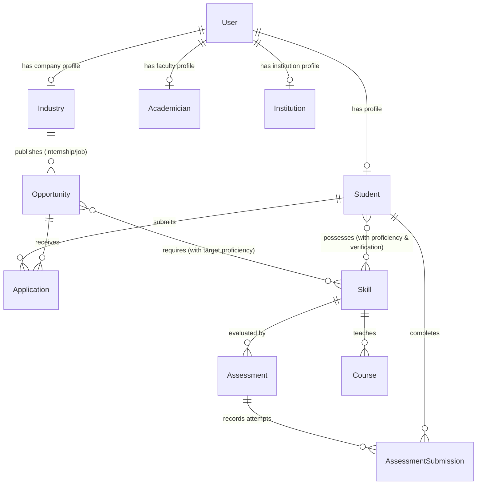
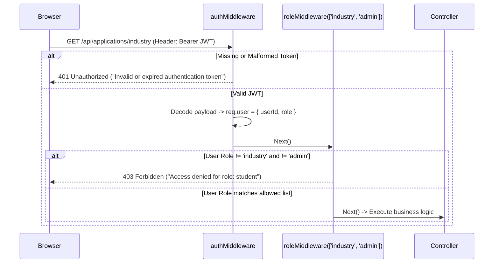
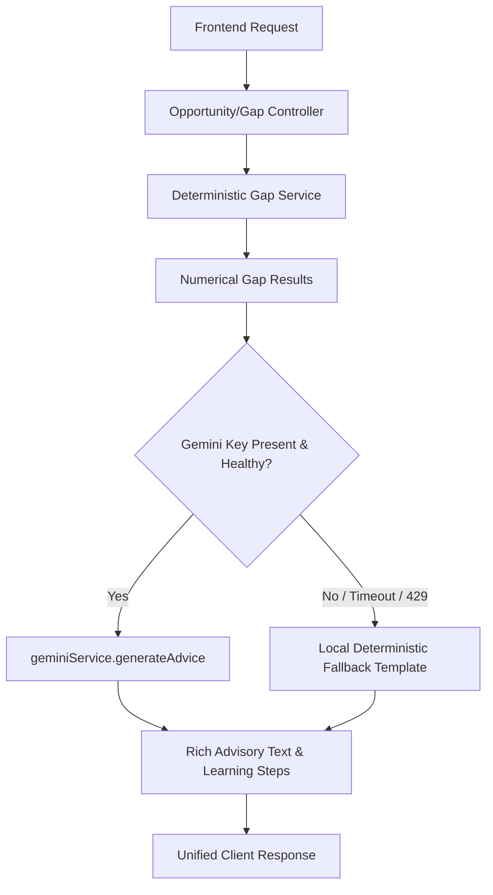
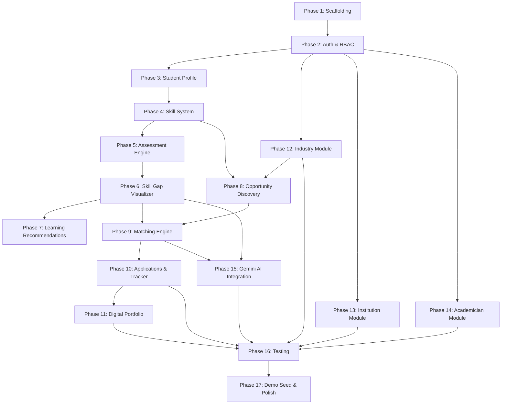
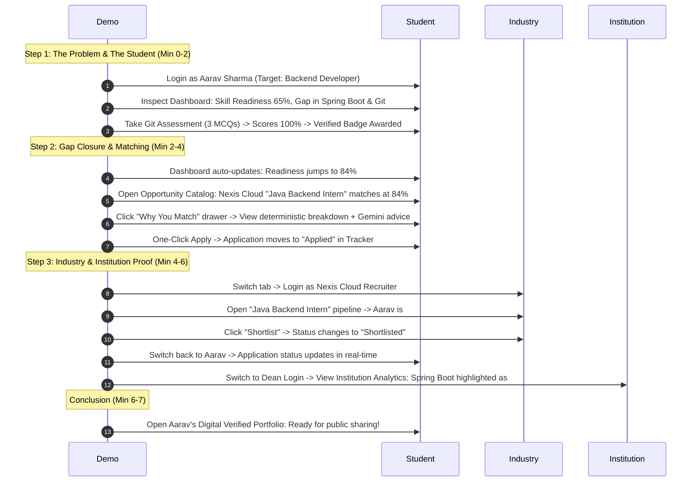

# Academia–Industry Collaboration Portal
## Master Execution Plan & Technical Blueprint

**Project Name:** Academia–Industry Collaboration Portal for Skill Mapping, Internships, and Placement  
**Document Type:** Master Architectural Execution Plan (Hackathon MVP to Full Product)  
**Target Root:** `c:\Users\SHIVA\Desktop\Academia_Portal\`  
**Date:** September 2026  
**Status:** Approved for Phased Implementation  

---

## Table of Contents
1. [Executive Summary](#1-executive-summary)
2. [Problem Understanding](#2-problem-understanding)
3. [Product Vision](#3-product-vision)
4. [User Roles & Personas](#4-user-roles--personas)
5. [Core User Journeys](#5-core-user-journeys)
6. [MVP Scope: P0, P1, P2, P3 Breakdown](#6-mvp-scope-p0-p1-p2-p3-breakdown)
7. [Detailed Feature Prioritization Matrix](#7-detailed-feature-prioritization-matrix)
8. [Technical Architecture](#8-technical-architecture)
9. [Proposed Project & Directory Structure](#9-proposed-project--directory-structure)
10. [Database Architecture & Mongoose Schemas](#10-database-architecture--mongoose-schemas)
11. [Authentication & Authorization Architecture](#11-authentication--authorization-architecture)
12. [API Architecture & Specification](#12-api-architecture--specification)
13. [Skill System Architecture](#13-skill-system-architecture)
14. [Skill-Gap Engine](#14-skill-gap-engine)
15. [Deterministic Matching Engine](#15-deterministic-matching-engine)
16. [AI Architecture (Gemini Integration & Fallback Strategy)](#16-ai-architecture-gemini-integration--fallback-strategy)
17. [UI/UX Architecture & Screen Planning](#17-uiux-architecture--screen-planning)
18. [Design System & UI Components](#18-design-system--ui-components)
19. [Realistic Demo Data Strategy](#19-realistic-demo-data-strategy)
20. [Development Phases (Phases 0–17)](#20-development-phases-phases-017)
21. [Feature Dependencies & Critical Path](#21-feature-dependencies--critical-path)
22. [Comprehensive Testing Strategy](#22-comprehensive-testing-strategy)
23. [Hackathon Demo Flow & Presentation Script](#23-hackathon-demo-flow--presentation-script)
24. [Risks, Constraints & Mitigation Strategies](#24-risks-constraints--mitigation-strategies)
25. [Definition of Done (DoD)](#25-definition-of-done-dod)
26. [Recommended Build Order & Immediate Next Steps](#26-recommended-build-order--immediate-next-steps)

---

## 1. Executive Summary

The **Academia–Industry Collaboration Portal** is a career-readiness and talent-matching platform engineered to bridge the widening chasm between higher-education curricula and fast-evolving industry requirements. Rather than operating as a conventional job board or an isolated learning management system (LMS), the platform introduces a continuous feedback loop:

$$\text{Assess} \longrightarrow \text{Map} \longrightarrow \text{Learn} \longrightarrow \text{Match} \longrightarrow \text{Apply} \longrightarrow \text{Track} \longrightarrow \text{Grow}$$

By combining **deterministic skill-gap algorithms**, **transparent opportunity compatibility scoring**, and **Gemini AI-powered personalized roadmaps**, students can diagnose exact deficiencies preventing them from landing target internships and entry-level positions. Simultaneously, industry partners can source pre-assessed, high-compatibility talent, academicians can discover collaborative research and FDPs, and institutions can access real-time cohort analytics regarding placement readiness and curriculum gaps.

This document serves as the sole, authoritative engineering blueprint for constructing the hackathon prototype and scaling it into a robust enterprise solution.

---

## 2. Problem Understanding

### 2.1 The Core Dilemma
Higher education institutions churn out millions of graduates annually. However, industry surveys consistently reveal that over 60% of graduates are deemed un-employable on day one due to:
1. **Curriculum Latency:** University syllabi lag behind real-world tech stacks (e.g., teaching legacy C/Java without modern frameworks, Git, CI/CD, or cloud-native paradigms).
2. **Skill Opacity:** Students assume high GPAs equate to career readiness, remaining unaware of their specific technical and soft-skill deficiencies until rejection letters arrive.
3. **Noisy Hiring:** Recruiters are overwhelmed with generic resumes lacking skill verification, leading to prolonged hiring cycles and mismatch.
4. **Institutional Blindspots:** University deans and placement cells lack quantifiable, real-time analytics on what skills the market is demanding vs. where their student cohorts falter.
5. **Isolated Academicians:** Faculty members lack structured channels for industry exposure, faculty development programs (FDPs), and collaborative industrial research.

### 2.2 The Solution Ecosystem
The platform addresses these systemic challenges through four synchronized modules:
```
  [Students]                  [Industries]
      │                            │
      ▼                            ▼
Assess & Discover Gaps      Define Skill Needs & Post Roles
      │                            │
      └───────────┬────────────────┘
                  ▼
         Matching & Skill Engine
                  ▲
      ┌───────────┴────────────────┐
      │                            │
  [Institutions]             [Academicians]
Track Cohort Gaps &        Industrial Training, FDPs &
Placement Readiness        Collaborative Research
```

---

## 3. Product Vision

### 3.1 Guiding Principles
* **Evidence Over Claims:** Distinguish strictly between self-reported skills, assessment-verified skills, and industry certifications.
* **Deterministic Scoring with Explainable AI:** Numerical match scores must be mathematically reproducible, while generative AI is reserved for qualitative reasoning, learning roadmaps, and career advisory.
* **Minimalist Professionalism:** Reject flashy hackathon gimmicks, excessive animations, and neon gradients. The platform emulates institutional-grade systems like Linear, Stripe, and Workday with high information density, calm typography, and crisp layouts.
* **Zero Blank States:** Every view must provide intuitive empty, loading, error, and recovery states.

### 3.2 Product Journey


---

## 4. User Roles & Personas

| Role | Primary Objectives | Key Touchpoints | Access Permissions |
| :--- | :--- | :--- | :--- |
| **Student** | Discover gaps, upskill, get matched to internships/jobs, track applications, maintain verified portfolio | Student Dashboard, Skill Assessments, Opportunity Discovery, Application Tracker, Portfolio | Read/Write own profile, applications, assessments; Read opportunities, courses |
| **Industry** | Post internships, jobs, live projects; discover pre-assessed candidates; manage applications | Recruiter Dashboard, Opportunity Builder, Candidate Discovery, Application Pipeline | Read/Write own company profile, postings; Read/Update applicants to own postings |
| **Academician** | Access industrial training, FDPs, consultancy, research collaborations, mentorship | Faculty Dashboard, FDP Catalog, Research Exchange, Mentorship Hub | Read/Write faculty profile; Read industry collaborations, FDPs; Apply to programs |
| **Institution / Admin** | Monitor student cohort readiness, track placement rates, analyze demanded vs. deficient skills, oversee platform data | Institution Analytics Dashboard, Student Tracker, Partner Management, System Admin | Read all cohort analytics, student outcomes; Administer users, taxonomy, postings |

---

## 5. Core User Journeys

### 5.1 Primary Student Journey (The Hero Hackathon Flow)


### 5.2 Industry Recruiter Journey
1. Recruiter logs in $\rightarrow$ Navigates to **Company Dashboard**.
2. Clicks **"Post Opportunity"** $\rightarrow$ Fills details for "Java Backend Intern" specifying required skills (`Java: Advanced`, `SQL: Intermediate`, `Git: Intermediate`, `Spring Boot: Intermediate`).
3. Sets eligibility thresholds (CGPA $\ge 7.0$, B.Tech 2026/2027).
4. Navigates to **"Talent Match"** $\rightarrow$ Backend returns scored candidate list matching criteria.
5. Reviews incoming student applications $\rightarrow$ Updates candidate status from `Applied` to `Shortlisted` $\rightarrow$ Triggers notification in student application tracker.

### 5.3 Academician Journey
1. Faculty member logs in $\rightarrow$ Enters specialization (Distributed Systems, Cloud Computing).
2. Browses **Faculty Development Programs (FDPs)** and **Industrial Training Modules** sponsored by industry partners.
3. Submits interest for **Collaborative Research / Consultancy** on industry live projects.

### 5.4 Institution Administrator Journey
1. Dean or Placement Officer logs in $\rightarrow$ Presented with **Institutional KPI Executive Summary**.
2. Observes cohort breakdown:
   * *Placement Ready:* 45%
   * *Under Training:* 38%
   * *Needs Intervention:* 17%
3. Inspects **Skill Demand vs. Deficit Chart**: Notice that 78% of local industry postings require *Docker & Cloud Deployment*, but only 22% of students have assessed proficiency $\rightarrow$ Generates curriculum advisory report.

---

## 6. MVP Scope: P0, P1, P2, P3 Breakdown

To prevent scope creep and ensure an immaculate, fully functional prototype for demo day, features are strictly triaged into four priorities:

```
┌─────────────────────────────────────────────────────────────┐
│ P0: MUST WORK (Hero Demo Story)                             │
│ • Auth & Role Routing                                       │
│ • Student Profile & Career Goal Selector                    │
│ • MCQ Skill Assessment Engine & Score Calculator            │
│ • Skill-Gap Analysis Visualizer (Current vs Required)       │
│ • Deterministic Opportunity Matching Engine                 │
│ • Internship Discovery with Match Explanation Badges        │
│ • One-Click Application & Real-time Status Tracker          │
│ • Digital Portfolio View (Summary, Skills, Verified Badges) │
│ • AI Fallback Graceful Degradation                          │
└─────────────────────────────────────────────────────────────┘
                               │
                               ▼
┌─────────────────────────────────────────────────────────────┐
│ P1: IMPORTANT (Supporting Ecosystem)                        │
│ • Industry Dashboard & "Post Opportunity" Builder           │
│ • Industry Application Management (Shortlist / Reject)      │
│ • Institution Analytics Dashboard (KPIs, Readiness, Gaps)   │
│ • Learning Recommendations / Course Directory               │
│ • Gemini AI Explanation for Gaps & Match Advice             │
└─────────────────────────────────────────────────────────────┘
                               │
                               ▼
┌─────────────────────────────────────────────────────────────┐
│ P2: SECONDARY (Depth & Realism)                             │
│ • Academician Dashboard & FDP Discovery                     │
│ • Entry-level Job Postings & Filter Module                  │
│ • Student Project & Certification Submissions               │
│ • Resume Analysis Parser (Gemini-assisted)                  │
└─────────────────────────────────────────────────────────────┘
                               │
                               ▼
┌─────────────────────────────────────────────────────────────┐
│ P3: FUTURE SCOPE (Post-Hackathon)                           │
│ • Live 1-on-1 Video Mentorship Integration                  │
│ • Automated Coding Sandbox Assessment (Monaco / Judge0)     │
│ • Multi-tenant University White-labeling                    │
│ • Direct ATS Integration (Greenhouse, Lever)                │
└─────────────────────────────────────────────────────────────┘
```

---

## 7. Detailed Feature Prioritization Matrix

| Feature | Role | Purpose | Dependencies | Frontend Specs | Backend Specs | DB Models | AI Requirement | Priority |
| :--- | :--- | :--- | :--- | :--- | :--- | :--- | :--- | :--- |
| **Authentication & RBAC** | All | Secure role-based login and session persistence | None | Clean auth forms, JWT storage in localStorage/cookies, role redirect | `/api/auth/register`, `/api/auth/login`, JWT verification middleware | `User` | None | **P0** |
| **Student Profile & Goal** | Student | Capture academic profile, bio, career direction | Auth | Profile form with degree, year, CGPA, target career goal pills | `/api/students/profile` GET/PUT | `Student`, `User` | Optional career suggestions | **P0** |
| **Skill Assessment Engine** | Student | Evaluate student proficiency with timed MCQs | Auth, Profile | Distraction-free quiz UI, progress bar, radio answers, instant result modal | `/api/assessments`, `/api/assessments/:id/submit` | `Assessment`, `Skill` | None (Deterministic scoring) | **P0** |
| **Skill-Gap Visualizer** | Student, Inst | Compare student skill level against industry target | Assessment, Profile | Comparative bar chart (Recharts) with deficit highlighting | `/api/students/skill-gap` calculation service | `Student`, `Skill`, `Job/Internship` | Gemini adds custom improvement tips | **P0** |
| **Matching Engine** | Student, Ind | Compute 0-100% compatibility score with breakdown | Profile, Opps, Skills | Match % badge, expandable "Why You Match" drawer/modal | `/api/matching/opportunities` deterministic formula service | `Student`, `Internship`, `Skill` | Explanatory narrative synthesis | **P0** |
| **Internship Discovery** | Student | Search, filter, and view opportunities | Opps in DB | Grid/Card view, filters for work-mode, stipend, role, match score | `/api/internships` with query filters | `Internship`, `Industry` | None | **P0** |
| **Application & Tracker** | Student, Ind | Apply to role and follow status progression | Opps, Profile | One-click apply button, visual stepper (`Applied` $\to$ `Review` $\to$ `Shortlisted`) | `/api/applications` POST/GET, status patch | `Application` | None | **P0** |
| **Digital Portfolio** | Student, Public | Sharable verified showcase of student skills and achievements | Assessments, Profile | Clean executive portfolio layout, verified checkmarks, share link | `/api/portfolio/:studentId` | `Student`, `Assessment` | None | **P0** |
| **Industry Opp Builder** | Industry | Publish new internships with skill requirements | Industry Auth | Multi-step form: basic info, required skills + minimum level, perks | `/api/internships` POST | `Internship`, `Industry` | None | **P1** |
| **Industry Candidate Pipeline** | Industry | View applicants, inspect match scores, shortlist/reject | Opp Builder, Apps | Candidate card list with match badges, status toggle buttons | `/api/applications/industry` GET/PATCH | `Application`, `Student` | None | **P1** |
| **Institution Analytics** | Institution | Institutional view of cohort readiness and skill gaps | Assessments, Apps | 4 Key KPIs + Bar chart (Skill Demand vs Gaps) + Line chart (Placement Trend) | `/api/analytics/institution` aggregation pipeline | Aggregation across `Student`, `Skill`, `Application` | None | **P1** |
| **Course Recommendations** | Student | Direct remedial courses mapped to identified gaps | Skill-Gap Engine | Card list of courses with duration, provider, enrolled button | `/api/courses` filtered by missing skill IDs | `Course` | Gemini generates custom learning roadmap | **P1** |
| **Academician Hub** | Academician | Faculty industrial training, FDPs & research collaboration | Academician Auth | Clean tabbed view for FDPs, Industry Projects, and Research Calls | `/api/academicians/opportunities` GET/POST | `Collaboration`, `Academician` | None | **P2** |
| **Job Discovery Module** | Student | Full-time entry level career postings | Auth | Filterable jobs list similar to internships | `/api/jobs` GET/POST | `Job`, `Industry` | None | **P2** |

---

## 8. Technical Architecture

### 8.1 System Architecture Diagram
```mermaid
graph TD
    subgraph Client Layer [Frontend: React + Vite + Tailwind CSS]
        UI_Router[React Router DOM]
        UI_AuthCtx[Auth Context & State]
        UI_Pages[Pages: Student, Industry, Inst, Acad]
        UI_Components[Reusable Design System Components]
        UI_Charts[Recharts Visualization Engine]
        UI_Axios[Axios HTTP Client with Interceptors]
    end

    subgraph Server Layer [Backend: Node.js + Express REST API]
        API_Gateway[Express Router & CORS Middleware]
        Auth_MW[JWT Auth & RBAC Middleware]
        Val_MW[Input Validation Middleware]
        
        subgraph Controllers
            C_Auth[AuthController]
            C_Student[StudentController]
            C_Skill[SkillController]
            C_Assess[AssessmentController]
            C_Opp[OpportunityController]
            C_App[ApplicationController]
            C_Analytics[AnalyticsController]
        end

        subgraph Business Services
            S_Match[Deterministic Matching Service]
            S_Gap[Skill-Gap Analysis Service]
            S_AI[Gemini AI Service + Fallback Handler]
            S_Assess[Assessment Evaluation Service]
        end
    end

    subgraph Data Layer
        Mongo[(MongoDB Database)]
        M_User[User Schema]
        M_Student[Student Schema]
        M_Industry[Industry Schema]
        M_Skill[Skill Taxonomy Schema]
        M_Opp[Internship / Job Schema]
        M_App[Application Schema]
        M_Assess[Assessment Schema]
    end

    subgraph External AI
        Gemini[Google Gemini 1.5/2.0 Flash API]
    end

    UI_Pages --> UI_Axios
    UI_Axios -->|REST / Bearer JWT| API_Gateway
    API_Gateway --> Auth_MW
    Auth_MW --> Val_MW
    Val_MW --> Controllers
    Controllers --> Business Services
    Business Services --> Mongo
    S_AI -->|HTTPS with API Key| Gemini
    S_AI -.->|Fallback on timeout/error| LocalFallback[Deterministic Local Fallbacks]
```

### 8.2 Architectural Layers & Responsibilities

1. **Frontend (Presentation & Interaction)**
   * **Framework:** React 18+ bootstrapped with Vite for lightning-fast HMR and build performance.
   * **Styling:** Vanilla Tailwind CSS configured with the strict, restrained color system defined in `GEMINI.md`.
   * **State Management:** React Context (`AuthContext`, `Theme/ToastContext`) for global session data; local component state for forms and UI controls.
   * **Visualizations:** Recharts for responsive, accessible bar charts, radar charts, and trend lines.
   * **HTTP Client:** Axios instance configured with base URLs, automatic Bearer JWT injection via request interceptors, and global 401/403 redirection via response interceptors.

2. **Backend (Business Logic & Security)**
   * **Framework:** Node.js with Express.js organized into strict `routes -> controllers -> services -> models` tiers.
   * **Security:** Helmet headers, CORS restricted to `CLIENT_URL`, express-rate-limit to mitigate brute force, bcrypt (salt rounds 10) for password hashing, and signed JWT tokens with 7-day expiration.
   * **Validation:** Explicit schema validation on all request payloads before reaching controller logic.
   * **AI Gateway:** All Gemini API interactions reside exclusively on the server side using the `@google/genai` or `@google/generative-ai` SDK. **API keys are never sent to the browser.**

3. **Data Layer (Persistence & Relations)**
   * **Database:** MongoDB accessed via Mongoose ODM.
   * **Patterns:** Normalized references for users, organizations, and skill taxonomy; embedded subdocuments for bounded, high-read collections (e.g., student skill ratings, assessment questions, application status histories).
   * **Indexing:** Compound indexes on frequently queried fields (e.g., `{ studentId: 1, opportunityId: 1 }` to guarantee unique applications).

---

## 9. Proposed Project & Directory Structure

The project will follow a clean separation between `frontend/` and `backend/` in the root workspace `c:\Users\SHIVA\Desktop\Academia_Portal\`:

```text
Academia_Portal/
│
├── frontend/                               # React + Vite Frontend Application
│   ├── public/                             # Static assets, favicon, logos
│   ├── src/
│   │   ├── assets/                         # SVG icons, illustrations, logo marks
│   │   ├── components/                     # Reusable UI component library
│   │   │   ├── common/                     # Primitive design system components
│   │   │   │   ├── Button.jsx              # Primary, Secondary, Outline, Danger variants
│   │   │   │   ├── Input.jsx               # Text, email, select, password with error states
│   │   │   │   ├── Card.jsx                # Standard white card container with subtle border
│   │   │   │   ├── Badge.jsx               # Status & category pill badges
│   │   │   │   ├── Modal.jsx               # Accessible dialog / popup wrapper
│   │   │   │   ├── ProgressBar.jsx         # Animated skill & completion progress bars
│   │   │   │   ├── Skeleton.jsx            # Loading skeleton placeholder components
│   │   │   │   └── EmptyState.jsx          # Friendly, informative empty states
│   │   │   ├── layout/                     # Application shell components
│   │   │   │   ├── Header.jsx              # Top header with profile dropdown & role indicator
│   │   │   │   ├── Sidebar.jsx             # Role-aware collapsible vertical navigation
│   │   │   │   ├── DashboardLayout.jsx     # Master container (Sidebar + Header + Content)
│   │   │   │   └── Footer.jsx              # Minimalist footer
│   │   │   ├── student/                    # Student-specific reusable widgets
│   │   │   │   ├── SkillScoreCard.jsx      # Overall score & proficiency indicators
│   │   │   │   ├── SkillGapChart.jsx       # Recharts bar visualizer for gap analysis
│   │   │   │   ├── OpportunityCard.jsx     # Internship/job card with match badge & quick apply
│   │   │   │   ├── MatchExplanationModal.jsx# "Why You Match" breakdown modal
│   │   │   │   ├── LearningRoadmap.jsx     # Step-by-step upskilling timeline
│   │   │   │   └── ApplicationTimeline.jsx # Visual status tracker (Applied -> Shortlisted)
│   │   │   ├── industry/                   # Industry recruiter widgets
│   │   │   │   ├── CandidateCard.jsx       # Matched candidate card with verified skills
│   │   │   │   └── ApplicationActionMenu.jsx# Status updater (Review, Shortlist, Reject)
│   │   │   ├── institution/                # Institutional analytics widgets
│   │   │   │   ├── KPICard.jsx             # Metrics summary tile with trend delta
│   │   │   │   ├── SkillDemandChart.jsx    # Demanded vs Available skills comparison
│   │   │   │   └── PlacementTrendChart.jsx # Historical placement rate graph
│   │   │   └── academician/                # Faculty widgets
│   │   │       └── CollaborationCard.jsx   # FDP and research project listing card
│   │   ├── context/                        # Global state providers
│   │   │   ├── AuthContext.jsx             # User token, role, login/logout functions
│   │   │   └── ToastContext.jsx            # Global notification system
│   │   ├── hooks/                          # Custom React hooks
│   │   │   ├── useAuth.js                  # Easy access to AuthContext
│   │   │   ├── useFetch.js                 # Generic query fetcher with loading/error state
│   │   │   └── useDebounce.js              # Debouncing search and filter inputs
│   │   ├── pages/                          # Routed views
│   │   │   ├── landing/                    # Public landing page
│   │   │   │   └── LandingPage.jsx
│   │   │   ├── auth/                       # Authentication views
│   │   │   │   ├── Login.jsx
│   │   │   │   ├── Register.jsx
│   │   │   │   └── Unauthorized.jsx
│   │   │   ├── student/                    # Student pages
│   │   │   │   ├── StudentDashboard.jsx    # Primary command center
│   │   │   │   ├── StudentProfile.jsx      # Profile editor & career goal selector
│   │   │   │   ├── SkillAssessments.jsx    # Assessment catalog
│   │   │   │   ├── AssessmentRunner.jsx    # Distraction-free quiz engine
│   │   │   │   ├── AssessmentResult.jsx    # Score summary & verified badge awards
│   │   │   │   ├── SkillGapAnalysis.jsx    # Detailed gap breakdown vs career goal
│   │   │   │   ├── LearningCatalog.jsx     # Recommended courses & workshops
│   │   │   │   ├── OpportunitySearch.jsx   # Internship & job discovery engine
│   │   │   │   ├── OpportunityDetails.jsx  # In-depth role specs & match explanation
│   │   │   │   ├── ApplicationTracker.jsx  # Active application status board
│   │   │   │   └── DigitalPortfolio.jsx    # Public/shareable student verified portfolio
│   │   │   ├── industry/                   # Industry pages
│   │   │   │   ├── IndustryDashboard.jsx   # Postings overview & incoming applications
│   │   │   │   ├── PostOpportunity.jsx     # Create internship/job wizard
│   │   │   │   ├── ManageApplications.jsx  # Candidate review & shortlisting pipeline
│   │   │   │   └── CandidateSearch.jsx     # Talent search by verified skills
│   │   │   ├── institution/                # Institution pages
│   │   │   │   ├── InstitutionDashboard.jsx# Cohort analytics & placement readiness
│   │   │   │   ├── StudentDirectory.jsx    # Student cohort list & gap filters
│   │   │   │   └── SkillDemandReport.jsx   # Industry demand trends
│   │   │   └── academician/                # Academician pages
│   │   │       ├── AcademicianDashboard.jsx# Faculty overview
│   │   │       ├── FDPCatalog.jsx          # Faculty development programs
│   │   │       └── ResearchCollaborations.jsx# Industry project proposals
│   │   ├── routes/                         # Navigation routing
│   │   │   ├── AppRoutes.jsx               # Master React Router definitions
│   │   │   └── ProtectedRoute.jsx          # Role-based access wrapper
│   │   ├── services/                       # API integration modules
│   │   │   ├── api.js                      # Axios instance with interceptors
│   │   │   ├── authService.js              # Auth endpoints
│   │   │   ├── studentService.js           # Student profiles, assessments, gaps
│   │   │   ├── opportunityService.js       # Internships and jobs
│   │   │   ├── applicationService.js       # Application submissions & status updates
│   │   │   ├── matchingService.js          # Client-side match helpers
│   │   │   └── analyticsService.js         # Institution metrics
│   │   ├── utils/                          # Helper functions & formatters
│   │   │   ├── formatters.js               # Currency, date, and percentage formatting
│   │   │   ├── constants.js                # Roles, skill levels, status enums
│   │   │   └── validators.js               # Form input validation rules
│   │   ├── App.jsx                         # App root component
│   │   ├── main.jsx                        # React DOM bootstrap
│   │   └── index.css                       # Tailwind directives & design system tokens
│   ├── index.html                          # HTML5 template with modern meta tags
│   ├── package.json                        # Frontend dependencies & scripts
│   ├── tailwind.config.js                  # Tailwind design system configuration
│   ├── postcss.config.js                   # PostCSS plugins
│   └── vite.config.js                      # Vite dev server & proxy settings
│
├── backend/                                # Node.js + Express REST API Server
│   ├── src/
│   │   ├── config/                         # Environment & database configuration
│   │   │   ├── db.js                       # Mongoose connection setup & lifecycle events
│   │   │   ├── env.js                      # Centralized environment variable validation
│   │   │   └── constants.js                # Enums for roles, statuses, and weights
│   │   ├── controllers/                    # Request/Response handlers
│   │   │   ├── authController.js           # User registration, login, profile check
│   │   │   ├── studentController.js        # Student profile CRUD & career goals
│   │   │   ├── skillController.js          # Taxonomy & skill queries
│   │   │   ├── assessmentController.js     # Quiz delivery & score evaluation
│   │   │   ├── opportunityController.js    # Internship/job creation & discovery
│   │   │   ├── applicationController.js    # Apply, track, and status modification
│   │   │   ├── matchingController.js       # Match calculation & explanation
│   │   │   ├── courseController.js         # Remedial courses & learning paths
│   │   │   ├── academicianController.js    # FDPs and faculty collaborations
│   │   │   └── analyticsController.js      # Institution cohort aggregations
│   │   ├── middleware/                     # Express middlewares
│   │   │   ├── authMiddleware.js           # Verify Bearer JWT token
│   │   │   ├── roleMiddleware.js           # Verify user role permissions
│   │   │   ├── validateMiddleware.js       # Payload schema validation
│   │   │   └── errorMiddleware.js          # Centralized error handler & status mapper
│   │   ├── models/                         # Mongoose Data Schemas
│   │   │   ├── User.js                     # Base auth user (email, password, role)
│   │   │   ├── Student.js                  # Student profile, academics, skill array
│   │   │   ├── Industry.js                 # Company profile, industry sector, contact
│   │   │   ├── Academician.js              # Faculty profile, dept, research focus
│   │   │   ├── Institution.js              # College profile, departments, stats
│   │   │   ├── Skill.js                    # Skill taxonomy (Java, React, Git, etc.)
│   │   │   ├── Assessment.js               # MCQs, skill linkage, difficulty, time limit
│   │   │   ├── AssessmentSubmission.js     # History of student quiz attempts & scores
│   │   │   ├── Opportunity.js              # Internship & Job postings
│   │   │   ├── Application.js              # Student application records & lifecycle
│   │   │   ├── Course.js                   # Recommended learning programs
│   │   │   └── Collaboration.js            # FDPs & research collaboration postings
│   │   ├── routes/                         # Express Route Definitions
│   │   │   ├── authRoutes.js               # /api/auth
│   │   │   ├── studentRoutes.js            # /api/students
│   │   │   ├── skillRoutes.js              # /api/skills
│   │   │   ├── assessmentRoutes.js         # /api/assessments
│   │   │   ├── opportunityRoutes.js        # /api/internships & /api/jobs
│   │   │   ├── applicationRoutes.js        # /api/applications
│   │   │   ├── matchingRoutes.js           # /api/matching
│   │   │   ├── courseRoutes.js             # /api/courses
│   │   │   ├── academicianRoutes.js        # /api/academicians
│   │   │   └── analyticsRoutes.js          # /api/analytics
│   │   ├── services/                       # Pure Business Logic
│   │   │   ├── matchingService.js          # Deterministic 5-factor scoring engine
│   │   │   ├── skillGapService.js          # Gap calculation (Required vs Current)
│   │   │   ├── geminiService.js            # Gemini API bridge with robust fallback
│   │   │   ├── assessmentService.js        # MCQ scoring & verified badge issuer
│   │   │   └── analyticsService.js         # MongoDB aggregation queries
│   │   ├── utils/                          # Backend utilities
│   │   │   ├── jwt.js                      # Token signing and verification helpers
│   │   │   ├── responseHandler.js          # Unified { success, data, message } wrapper
│   │   │   └── seedData.js                 # Complete realistic demo seeder script
│   │   ├── server.js                       # Express application bootstrap
│   │   └── package.json                    # Backend dependencies & scripts
│
├── GEMINI.md                               # Project Rules & Specifications (Root)
├── BusinessGuidelines.md                   # Core Product Domain Guidelines (Root)
├── frontend.md                             # Frontend Rules & Standards (Root)
├── backend.md                              # Backend Architecture Rules (Root)
├── database.md                             # Database & Schema Rules (Root)
├── security.md                             # Security & Secrets Protocols (Root)
├── build-feature.md                        # Feature Implementation Workflow (Root)
├── .env.example                            # Master Environment Template (Root)
├── EXECUTION_PLAN.md                       # This Master Execution Blueprint (Root)
├── .gitignore                              # Git exclusion rules
└── README.md                               # Project Overview & Quickstart Guide
```

---

## 10. Database Architecture & Mongoose Schemas

### 10.1 Entity-Relationship (ER) Diagram


### 10.2 MVP Core Mongoose Schemas

#### 1. `User` Schema
* **Purpose:** Centralized credentials and role-based identity.
```javascript
const UserSchema = new mongoose.Schema({
  email: { type: String, required: true, unique: true, lowercase: true, trim: true, index: true },
  password: { type: String, required: true, select: false },
  role: { 
    type: String, 
    required: true, 
    enum: ['student', 'industry', 'academician', 'institution', 'admin'],
    default: 'student',
    index: true 
  },
  isVerified: { type: Boolean, default: true },
  lastLogin: { type: Date }
}, { timestamps: true });
```

#### 2. `Student` Schema
* **Purpose:** Academic profile, career aspirations, and composite skill profile.
```javascript
const StudentSchema = new mongoose.Schema({
  userId: { type: mongoose.Schema.Types.ObjectId, ref: 'User', required: true, unique: true, index: true },
  fullName: { type: String, required: true, trim: true },
  phone: { type: String, trim: true },
  avatarUrl: { type: String },
  institutionName: { type: String, required: true },
  degree: { type: String, required: true }, // e.g. B.Tech Computer Science
  department: { type: String, required: true },
  graduationYear: { type: Number, required: true },
  cgpa: { type: Number, min: 0, max: 10, required: true },
  careerGoals: [{ type: String, trim: true }], // e.g. ["Full Stack Developer", "Backend Engineer"]
  skills: [{
    skillId: { type: mongoose.Schema.Types.ObjectId, ref: 'Skill', required: true },
    skillName: { type: String, required: true },
    category: { type: String, enum: ['Technical', 'Soft Skill', 'Domain'] },
    proficiency: { 
      type: String, 
      enum: ['Beginner', 'Intermediate', 'Advanced', 'Expert'], 
      default: 'Beginner' 
    },
    verificationStatus: { 
      type: String, 
      enum: ['Self-reported', 'Assessment-verified', 'Certification-verified'], 
      default: 'Self-reported' 
    },
    verifiedScore: { type: Number, min: 0, max: 100 },
    verifiedAt: { type: Date }
  }],
  projects: [{
    title: { type: String, required: true },
    description: { type: String },
    technologies: [String],
    repoLink: { type: String },
    liveLink: { type: String }
  }],
  certifications: [{
    name: { type: String, required: true },
    issuer: { type: String, required: true },
    issueDate: { type: Date },
    credentialUrl: { type: String }
  }],
  resumeUrl: { type: String },
  bio: { type: String, maxLength: 500 }
}, { timestamps: true });
```

#### 3. `Skill` Schema (Taxonomy)
* **Purpose:** Master repository of industry skills with standardized categories and benchmarks.
```javascript
const SkillSchema = new mongoose.Schema({
  name: { type: String, required: true, unique: true, trim: true, index: true },
  category: { 
    type: String, 
    required: true, 
    enum: ['Technical', 'Soft Skill', 'Domain'],
    index: true 
  },
  description: { type: String },
  industryDemandWeight: { type: Number, min: 1, max: 10, default: 5 }
}, { timestamps: true });
```

#### 4. `Assessment` & `AssessmentSubmission` Schemas
* **Purpose:** Distraction-free technical assessments with objective question banks.
```javascript
const AssessmentSchema = new mongoose.Schema({
  title: { type: String, required: true },
  targetSkillId: { type: mongoose.Schema.Types.ObjectId, ref: 'Skill', required: true, index: true },
  skillName: { type: String, required: true },
  difficulty: { type: String, enum: ['Beginner', 'Intermediate', 'Advanced'], default: 'Intermediate' },
  durationMinutes: { type: Number, default: 15 },
  passingScorePercentage: { type: Number, default: 70 },
  questions: [{
    questionText: { type: String, required: true },
    options: [{ type: String, required: true }],
    correctOptionIndex: { type: Number, required: true, select: false }, // Never exposed during quiz
    explanation: { type: String }
  }]
}, { timestamps: true });

const AssessmentSubmissionSchema = new mongoose.Schema({
  studentId: { type: mongoose.Schema.Types.ObjectId, ref: 'Student', required: true, index: true },
  assessmentId: { type: mongoose.Schema.Types.ObjectId, ref: 'Assessment', required: true },
  skillId: { type: mongoose.Schema.Types.ObjectId, ref: 'Skill', required: true },
  scorePercentage: { type: Number, required: true, min: 0, max: 100 },
  passed: { type: Boolean, required: true },
  awardedProficiency: { type: String, enum: ['Beginner', 'Intermediate', 'Advanced', 'Expert'] },
  questionResponses: [{
    questionIndex: Number,
    selectedOption: Number,
    isCorrect: Boolean
  }],
  completedAt: { type: Date, default: Date.now }
}, { timestamps: true });
```

#### 5. `Opportunity` Schema (Internships & Jobs)
* **Purpose:** Corporate positions specifying clear skill requirements and eligibility bounds.
```javascript
const OpportunitySchema = new mongoose.Schema({
  industryId: { type: mongoose.Schema.Types.ObjectId, ref: 'Industry', required: true, index: true },
  companyName: { type: String, required: true },
  companyLogo: { type: String },
  type: { type: String, required: true, enum: ['internship', 'job', 'project'], default: 'internship', index: true },
  title: { type: String, required: true, trim: true },
  description: { type: String, required: true },
  workMode: { type: String, enum: ['Remote', 'Onsite', 'Hybrid'], default: 'Hybrid' },
  location: { type: String, default: 'Flexible' },
  duration: { type: String, default: '3 Months' }, // for internships
  stipendOrSalary: { type: String, default: 'Performance Based' },
  openingsCount: { type: Number, default: 1 },
  deadline: { type: Date, required: true },
  eligibility: {
    minCgpa: { type: Number, default: 6.0 },
    allowedDegrees: [String],
    graduatingYears: [Number]
  },
  requiredSkills: [{
    skillId: { type: mongoose.Schema.Types.ObjectId, ref: 'Skill', required: true },
    skillName: { type: String, required: true },
    minProficiency: { 
      type: String, 
      enum: ['Beginner', 'Intermediate', 'Advanced', 'Expert'], 
      default: 'Intermediate' 
    },
    weight: { type: Number, default: 1 } // relative importance
  }],
  preferredSkills: [String],
  isActive: { type: Boolean, default: true, index: true }
}, { timestamps: true });
```

#### 6. `Application` Schema
* **Purpose:** Auditable progression lifecycle for candidate submissions.
```javascript
const ApplicationSchema = new mongoose.Schema({
  opportunityId: { type: mongoose.Schema.Types.ObjectId, ref: 'Opportunity', required: true, index: true },
  studentId: { type: mongoose.Schema.Types.ObjectId, ref: 'Student', required: true, index: true },
  industryId: { type: mongoose.Schema.Types.ObjectId, ref: 'Industry', required: true },
  status: { 
    type: String, 
    enum: ['Applied', 'Under Review', 'Shortlisted', 'Interview', 'Selected', 'Rejected'], 
    default: 'Applied',
    index: true 
  },
  calculatedMatchScore: { type: Number, min: 0, max: 100 },
  matchBreakdown: {
    skillScore: Number,
    eligibilityScore: Number,
    careerInterestScore: Number,
    matchedSkills: [String],
    missingSkills: [String]
  },
  recruiterNotes: { type: String },
  statusHistory: [{
    status: String,
    changedAt: { type: Date, default: Date.now },
    notes: String
  }]
}, { timestamps: true });

// Prevent duplicate applications
ApplicationSchema.index({ opportunityId: 1, studentId: 1 }, { unique: true });
```

#### 7. `Course` Schema (Remedial Learning)
* **Purpose:** Curated learning modules mapped directly to skill deficiencies.
```javascript
const CourseSchema = new mongoose.Schema({
  title: { type: String, required: true },
  provider: { type: String, required: true }, // e.g. "Coursera", "Industry Partner"
  skillsCovered: [{ type: mongoose.Schema.Types.ObjectId, ref: 'Skill' }],
  skillNames: [String],
  durationHours: { type: Number, default: 10 },
  level: { type: String, enum: ['Beginner', 'Intermediate', 'Advanced'], default: 'Beginner' },
  url: { type: String, required: true },
  thumbnail: { type: String }
}, { timestamps: true });
```

---

## 11. Authentication & Authorization Architecture

### 11.1 Security Implementation Details
1. **Password Hashing:** `bcryptjs` with salt rounds = 10. Passwords are never returned in database query projections (`select: false`).
2. **Tokens:** Cryptographically signed JSON Web Tokens (JWT) containing `{ userId, role }`. Expiration set to 7 days.
3. **Storage:** Stored in client `localStorage` and dispatched via standard HTTP header `Authorization: Bearer <token>`.
4. **Role-Based Access Control (RBAC):** Middleware checks verify role authorization before invoking controller logic.



### 11.2 Role Access Matrix

| Route Namespace | Student | Industry | Academician | Institution | Admin |
| :--- | :---: | :---: | :---: | :---: | :---: |
| `/api/auth/*` | Public / Self | Public / Self | Public / Self | Public / Self | Public / Self |
| `/api/students/profile` | Full CRUD | Read-only (Public) | Read-only (Public) | Read-only | Full CRUD |
| `/api/assessments/submit` | Yes | No | No | No | Yes |
| `/api/internships` (GET) | Yes | Yes | Yes | Yes | Yes |
| `/api/internships` (POST/PUT) | No | Yes (Own) | No | No | Yes (All) |
| `/api/applications` (POST) | Yes | No | No | No | No |
| `/api/applications/industry` | No | Yes (Own) | No | No | Yes (All) |
| `/api/analytics/institution` | No | No | No | Yes | Yes |
| `/api/academicians/*` | No | No | Full CRUD | Read-only | Yes |

---

## 12. API Architecture & Specification

All API endpoints follow a standardized, predictable JSON envelope format:
* **Success Response:** `{ "success": true, "data": { ... } }`
* **Error Response:** `{ "success": false, "message": "Clear explanation of error" }`

### 12.1 Core MVP Endpoints

#### 1. Authentication
* `POST /api/auth/register`
  * **Role:** Public
  * **Body:** `{ email, password, role, fullName, institutionName, degree, graduationYear }`
  * **Response:** `{ success: true, data: { token, user: { id, email, role, fullName } } }`
* `POST /api/auth/login`
  * **Role:** Public
  * **Body:** `{ email, password }`
  * **Response:** `{ success: true, data: { token, user: { id, email, role, fullName } } }`
* `GET /api/auth/me`
  * **Role:** Authenticated
  * **Response:** Current user details and hydrated profile record.

#### 2. Student Profile & Gaps
* `GET /api/students/profile`
  * **Role:** `student`
  * **Response:** Full student profile including skills, verified scores, projects, and target career goals.
* `PUT /api/students/profile`
  * **Role:** `student`
  * **Body:** `{ fullName, cgpa, careerGoals, projects, bio }`
* `GET /api/students/skill-gap`
  * **Role:** `student`, `institution`
  * **Query:** `?careerGoal=Full+Stack+Developer`
  * **Response:** Computed required skills, current proficiency, gap level, and remedial courses.

#### 3. Assessments
* `GET /api/assessments`
  * **Role:** `student`
  * **Query:** `?skillId=...`
  * **Response:** List of available assessments with difficulty and estimated duration.
* `GET /api/assessments/:id`
  * **Role:** `student`
  * **Response:** Assessment questions (options included, correct indices strictly stripped).
* `POST /api/assessments/:id/submit`
  * **Role:** `student`
  * **Body:** `{ responses: [{ questionIndex: 0, selectedOption: 2 }, ...] }`
  * **Response:** `{ success: true, data: { scorePercentage: 85, passed: true, newProficiency: "Advanced", verifiedBadgeAwarded: true } }`

#### 4. Opportunities & Matching
* `GET /api/internships`
  * **Role:** Authenticated
  * **Query:** `?search=...&workMode=...&sort=match`
  * **Response:** Array of opportunities with real-time match scores calculated against the requesting student's profile.
* `GET /api/internships/:id`
  * **Role:** Authenticated
  * **Response:** In-depth opportunity specs, company information, and deterministic match breakdown.
* `POST /api/internships`
  * **Role:** `industry`, `admin`
  * **Body:** `{ title, description, workMode, location, duration, stipendOrSalary, deadline, eligibility, requiredSkills }`

#### 5. Applications
* `POST /api/applications`
  * **Role:** `student`
  * **Body:** `{ opportunityId }`
  * **Response:** `{ success: true, data: { applicationId, status: "Applied", appliedAt: "..." } }`
* `GET /api/applications/student`
  * **Role:** `student`
  * **Response:** List of all submitted applications with current status, timeline history, and opportunity details.
* `GET /api/applications/industry/:opportunityId`
  * **Role:** `industry`, `admin`
  * **Response:** Candidate pipeline sorted by calculated match score.
* `PATCH /api/applications/:id/status`
  * **Role:** `industry`, `admin`
  * **Body:** `{ status: "Shortlisted" | "Under Review" | "Selected" | "Rejected", notes: "..." }`

#### 6. Institutional Analytics
* `GET /api/analytics/institution`
  * **Role:** `institution`, `admin`
  * **Response:** Cohort KPI counts, placement readiness percentages, top 5 demanded skills, and top 5 deficit skills.

---

## 13. Skill System Architecture

### 13.1 Taxonomy & Categories
Every skill in the portal belongs to one of three standardized categories:
1. **Technical:** Specific programming languages, frameworks, databases, and DevOps tools (e.g., Python, React, Node.js, Docker, MongoDB).
2. **Soft Skill:** Cross-functional competencies (e.g., Problem Solving, Team Collaboration, Communication, Time Management).
3. **Domain:** Industry-specific specialization (e.g., FinTech, Healthcare Informatics, Cloud Architecture, Embedded Systems).

### 13.2 Proficiency Levels & Weight Scale
Proficiencies are mapped to an ordinal integer scale $[1, 4]$ for arithmetic calculations:

| Level | Ordinal Value | Benchmark Description |
| :--- | :---: | :--- |
| **Beginner** | 1 | Knows syntax and basic theory; requires guidance for simple tasks. |
| **Intermediate** | 2 | Can build functional modules, debug common issues, and work with APIs. |
| **Advanced** | 3 | Thorough grasp of best practices, system architecture, and performance tuning. |
| **Expert** | 4 | Deep architectural mastery, library authoring, and production incident leadership. |

### 13.3 Skill Verification Hierarchy
Data credibility is paramount:
```
[Self-Reported] (Weight: 0.60)
       ↓  (Passes Portal Assessment)
[Assessment-Verified] (Weight: 1.00)
       ↓  (Attaches Accredited Credential)
[Certification-Verified] (Weight: 1.00)
```
When computing skill-gap matching, an `Assessment-Verified` skill level carries full weight ($1.0$), whereas a unverified `Self-Reported` skill carries a discounted weight ($0.6$) to motivate students to validate their competencies through assessments.

---

## 14. Skill-Gap Engine

### 14.1 Gap Computation Algorithm
A skill gap occurs whenever the target requirement exceeds the student's verified capability:

$$\text{Gap Score}(S_i) = \max\left(0, \text{RequiredLevel}(S_i) - \text{StudentLevel}(S_i)\right)$$

Where:
* $\text{RequiredLevel} \in \{1, 2, 3, 4\}$
* $\text{StudentLevel} \in \{0, 1, 2, 3, 4\}$ ($0$ if the student does not possess the skill).

### 14.2 Mathematical Normalization
For a given opportunity or career goal requiring $N$ skills, the overall **Skill Gap Percentage** is defined as:

$$\text{Total Skill Gap \%} = \frac{\sum_{i=1}^N \max(0, R_i - A_i)}{\sum_{i=1}^N R_i} \times 100$$

Where $R_i$ is the required level for skill $i$, and $A_i$ is the student's verified level.

### 14.3 Concrete Calculation Example

| Required Skill | Required Level ($R_i$) | Student Level ($A_i$) | Verification Status | Effective Level ($A_i'$) | Gap ($R_i - A_i'$) | Status |
| :--- | :---: | :---: | :---: | :---: | :---: | :--- |
| **Java** | Advanced (3) | Advanced (3) | Verified | 3.0 | 0.0 | **Full Match** |
| **SQL** | Intermediate (2) | Intermediate (2) | Verified | 2.0 | 0.0 | **Full Match** |
| **Git** | Intermediate (2) | Beginner (1) | Verified | 1.0 | 1.0 | **Moderate Gap** |
| **Spring Boot** | Intermediate (2) | None (0) | N/A | 0.0 | 2.0 | **Critical Gap** |

* $\sum R_i = 3 + 2 + 2 + 2 = 9$
* $\sum \text{Gaps} = 0 + 0 + 1 + 2 = 3$
* **Total Skill Gap:** $\frac{3}{9} \times 100 = \mathbf{33.3\%}$
* **Skill Match Score:** $100\% - 33.3\% = \mathbf{66.7\%}$

---

## 15. Deterministic Matching Engine

### 15.1 Multi-Factor Scoring Formula
The portal does not delegate numerical compatibility to an unpredictable LLM. Instead, a multi-factor deterministic formula guarantees consistency, fairness, and instant speed:

$$\text{Final Match Score} = (W_{\text{skill}} \times S_{\text{skill}}) + (W_{\text{goal}} \times S_{\text{goal}}) + (W_{\text{elig}} \times S_{\text{elig}}) + (W_{\text{cgpa}} \times S_{\text{cgpa}}) + (W_{\text{pref}} \times S_{\text{pref}})$$

### 15.2 Configurable Weights & Factors

| Factor | Default Weight | Scoring Criteria |
| :--- | :---: | :--- |
| **Skill Compatibility ($S_{\text{skill}}$)** | **50%** | Percentage of required skills met, taking into account verification discounts. |
| **Career Interest ($S_{\text{goal}}$)** | **20%** | $100\%$ if opportunity title/type matches student's declared career goals; $50\%$ if related; $0\%$ if unrelated. |
| **Eligibility ($S_{\text{elig}}$)** | **15%** | $100\%$ if student meets degree and graduation year filters; $0\%$ if disqualified (mandatory gates can also reject). |
| **Academic Performance ($S_{\text{cgpa}}$)** | **10%** | Scaled score: $\min\left(100, \frac{\text{Student CGPA}}{\text{Min Required CGPA}} \times 80\right)$. |
| **Work Mode / Preference ($S_{\text{pref}}$)** | **5%** | $100\%$ if work mode (Remote/Hybrid/Onsite) aligns with student preference. |

### 15.3 Transparent Match Breakdown
The matching engine returns not just a single integer, but a structured payload powering the frontend "Why You Match" drawer:
```json
{
  "matchPercentage": 87,
  "breakdown": {
    "skillScore": 90,
    "careerInterestScore": 100,
    "eligibilityScore": 100,
    "cgpaScore": 85
  },
  "matchedSkills": ["Java", "SQL", "Git"],
  "missingSkills": ["Spring Boot"],
  "eligibilityStatus": "Eligible",
  "disclaimer": "Match score estimates compatibility based on verified skills and stated requirements. It does not guarantee interview selection or hiring."
}
```

---

## 16. AI Architecture (Gemini Integration & Fallback Strategy)

### 16.1 AI Integration Boundary
* **Strict Security Rule:** The Gemini API is invoked exclusively by the backend service `geminiService.js`. The API key `GEMINI_API_KEY` is loaded from server environment variables and is never exposed in client bundles.
* **Deterministic Core:** Numerical matching and assessment scoring remain strictly programmatic. AI provides contextual synthesis, actionable learning roadmaps, and qualitative profile tips.



### 16.2 Key AI Features & Fallback Strategy

| Feature | Input to Gemini | Desired Output | Fallback Behavior (When Gemini Offline) |
| :--- | :--- | :--- | :--- |
| **1. Skill-Gap Explanation** | Target Goal, Missing Skills (`["Spring Boot", "Docker"]`), Current Level | 2-sentence conversational diagnosis + 3 immediate practical learning steps | Template: *"To become a Full Stack Developer, focus on mastering Spring Boot and Docker. Start by containerizing a basic CRUD API."* |
| **2. Learning Roadmap Generator** | Student skill deficits, available course catalog | Ordered 4-step sequence connecting current skills to gap closure | Pre-mapped dependency order from static curriculum graph (`Git` $\to$ `Spring Boot` $\to$ `Docker`) |
| **3. Opportunity Match Explanation** | Matched skills, missing skills, company expectations | Nuanced paragraph explaining why the candidate is a strong contender despite minor gaps | Deterministic bullet points: *"Strong matches in 3/4 skills. Closing the Spring Boot gap will raise match to 95%."* |
| **4. Career Guidance Advisor** | Profile summary, top assessed skills, CGPA | Top 3 recommended career tracks with projected demand | Rule-based mapping based on top assessed skill category |

---

## 17. UI/UX Architecture & Screen Planning

### 17.1 Layout Philosophy & Structure
In accordance with `GEMINI.md` and `frontend.md`, all authenticated screens inherit a unified, distraction-free shell:
```text
┌────────────────────────────────────────────────────────────────────────┐
│ Top Header: Portal Brand | Breadcrumbs | Notification Bell | User Menu │
├───────────────────┬────────────────────────────────────────────────────┤
│                   │                                                    │
│ Minimal Sidebar   │ Main Content Canvas (Scrollable)                   │
│ • Dashboard       │ Page Title + Primary Action                        │
│ • Skill Profile   │ ────────────────────────────────────────────────── │
│ • Assessments     │ Key KPI Summary Cards (3-4 Tiles)                  │
│ • Opportunities   │ ────────────────────────────────────────────────── │
│ • Applications    │ Primary Analytical Section (Charts / Data Grid)    │
│ • Portfolio       │ ────────────────────────────────────────────────── │
│ • Settings        │ Actionable Recommendations / Recent Timeline       │
│                   │                                                    │
└───────────────────┴────────────────────────────────────────────────────┘
```

### 17.2 Complete Screen Inventory

#### 1. Student Screens (The Hero Journey)
1. **Landing Page:** Professional value proposition, role-selection entry cards, problem breakdown, and trust indicators.
2. **Student Registration / Login:** Clean, split-pane forms with client-side validation and immediate role-directed routing.
3. **Student Dashboard:** Real-time KPI cards (Skill Readiness Score, Identified Gaps, Active Applications, Recommended Matches), progress visualizer, and top recommended internships.
4. **Student Profile:** Academic details, degree, graduation year, CGPA, target career goal pills, and self-reported skills.
5. **Skill Catalog & Assessments:** List of available technical quizzes with difficulty badges and completion indicators.
6. **Assessment Runner:** Distraction-free quiz canvas (Sidebar collapsed, progress indicator `Question X of Y`, single question card, options, Previous/Next controls).
7. **Assessment Result:** Instant score presentation, correct answer review, awarded verified badges, and link to updated gap analysis.
8. **Skill-Gap Analysis:** Comparative Recharts bar visualization (Required Level vs Current Level) for selected career goal, with immediate "Learn This Skill" buttons.
9. **Learning Recommendations:** Curated course and tutorial directory mapped to closing active deficits.
10. **Internship Discovery:** Searchable, filterable opportunity grid with match percentage badges and stipend/mode chips.
11. **Opportunity Details:** Full job specification, company background, eligibility verification, and "Why You Match" drawer.
12. **Application Tracker:** Visual status board/timeline tracking active submissions from `Applied` to `Selected`.
13. **Digital Portfolio:** Clean, executive-ready profile showcasing verified skills, assessment badges, and completed projects.

#### 2. Industry Screens
14. **Industry Dashboard:** Active postings count, total applicants received, shortlisted candidates tile, and incoming application list.
15. **Post Opportunity Wizard:** Step-by-step creation form for internships/jobs with required skill selection and minimum proficiencies.
16. **Candidate Pipeline & Review:** Candidate list sorted by match percentage, with drawer to inspect verified student profiles and status updater buttons (`Shortlist`, `Interview`, `Reject`).

#### 3. Institution Screens
17. **Institution Analytics Dashboard:** Macro view of cohort placement readiness, skill demand vs. deficit charts, and departmental placement progress.

#### 4. Academician Screens
18. **Academician Dashboard & Collaboration Exchange:** Industry-sponsored Faculty Development Programs (FDPs), industrial training sessions, and research calls.

---

## 18. Design System & UI Components

### 18.1 Restrained Color Palette Tokens
Strict adherence to `GEMINI.md`:

```css
:root {
  /* Canvas & Containers */
  --color-bg: #F8FAFC;            /* Main App Background (Slate 50) */
  --color-card: #FFFFFF;          /* Card Background (Pure White) */
  --color-border: #E2E8F0;        /* Subtle Divider Border (Slate 200) */
  --color-border-hover: #CBD5E1;  /* Slate 300 */

  /* Typography */
  --color-text-primary: #0F172A;  /* Slate 900 */
  --color-text-secondary: #64748B;/* Slate 500 */
  --color-text-muted: #94A3B8;    /* Slate 400 */

  /* Brand Primary */
  --color-primary: #4F46E5;       /* Indigo 600 */
  --color-primary-hover: #4338CA; /* Indigo 700 */
  --color-primary-light: #EEF2FF; /* Indigo 50 */

  /* Semantic Feedback */
  --color-success: #10B981;       /* Emerald 500 */
  --color-success-light: #ECFDF5; /* Emerald 50 */
  --color-warning: #F59E0B;       /* Amber 500 */
  --color-warning-light: #FFFBEB; /* Amber 50 */
  --color-danger: #EF4444;        /* Rose 500 */
  --color-danger-light: #FEF2F2;  /* Rose 50 */
}
```

### 18.2 Typography & Spacing Hierarchy
* **Font Family:** `Inter, system-ui, -apple-system, sans-serif`.
* **Headings:** Bold/Semibold, tight letter-spacing (`tracking-tight`), compact margins.
* **Cards:** Border `border border-slate-200`, subtle elevation `shadow-sm`, consistent padding `p-6`, rounded corners `rounded-xl`.
* **Buttons:**
  * *Primary:* Indigo background, white text, subtle hover lift (`bg-indigo-600 hover:bg-indigo-700 text-white font-medium px-4 py-2 rounded-lg transition-colors`).
  * *Secondary:* White background, slate border, dark slate text (`bg-white border border-slate-300 hover:bg-slate-50 text-slate-700 px-4 py-2 rounded-lg`).
  * *Danger:* Red text and border, red hover fill for destructive actions.

---

## 19. Realistic Demo Data Strategy

To deliver an airtight, memorable demonstration, a comprehensive seed script `backend/src/utils/seedData.js` will populate a cohesive end-to-end scenario:

### 19.1 Demo Personas

1. **The Hero Student:**
   * **Name:** *Aarav Sharma* (`student@academia.edu` / `Password123!`)
   * **Institution:** National Institute of Technology
   * **Degree:** B.Tech Computer Science (Final Year, CGPA 8.4)
   * **Target Goal:** *Backend Developer*
   * **Initial State:** Self-reported Java (Advanced) and SQL (Intermediate). Lacks Spring Boot and Git verification.

2. **The Industry Partner:**
   * **Company:** *Nexis Cloud Technologies* (`recruiter@nexis.io` / `Password123!`)
   * **Posting:** *Java Backend Intern*
   * **Requirements:**
     * `Java` $\ge$ Advanced (Weight: 3)
     * `SQL` $\ge$ Intermediate (Weight: 2)
     * `Git` $\ge$ Intermediate (Weight: 2)
     * `Spring Boot` $\ge$ Intermediate (Weight: 2)

3. **The Institution Admin:**
   * **Name:** *Dr. Ramesh Rao*, Dean of Placements (`dean@academia.edu` / `Password123!`)

4. **The Academician:**
   * **Name:** *Prof. Sunita Menon*, Dept of CSE (`faculty@academia.edu` / `Password123!`)

### 19.2 The Golden Seed Narrative
1. Aarav logs in $\rightarrow$ Dashboard highlights a **Skill Gap in Spring Boot and Git** for his chosen *Backend Developer* goal.
2. Aarav takes the **Git Assessment** $\rightarrow$ Scores 90% $\rightarrow$ Receives **Assessment-Verified Badge**.
3. Match score for Nexis Cloud's *Java Backend Intern* increases from **65% to 84%**.
4. Aarav reviews the match breakdown $\rightarrow$ Views recommended course *"Spring Boot Microservices Fundamentals"*.
5. Aarav submits an application to *Nexis Cloud Technologies*.
6. Switch to Nexis Recruiter login $\rightarrow$ Aarav appears at the top of the candidate queue with 84% match $\rightarrow$ Recruiter shortlists Aarav $\rightarrow$ Status changes to `Shortlisted`.
7. Switch to Dean login $\rightarrow$ Institution dashboard reflects updated cohort placement readiness and identifies *Spring Boot* as the top departmental skill gap.

---

## 20. Development Phases (Phases 0–17)

```mermaid
gantt
    title Phased Implementation Roadmap
    dateFormat  X
    axisFormat %d
    section Foundation
    Phase 0: Architecture & Planning          :done, p0, 0, 1
    Phase 1: Project Scaffolding & Setup      :active, p1, 1, 2
    Phase 2: Auth & Role Middleware           :p2, 2, 4
    section Student Hero Flow
    Phase 3: Student Profile & Dashboard      :p3, 4, 6
    Phase 4: Skill Taxonomy & Management      :p4, 6, 7
    Phase 5: Assessment Engine                :p5, 7, 9
    Phase 6: Skill-Gap Visualizer             :p6, 9, 11
    Phase 7: Learning Recommendations         :p7, 11, 12
    Phase 8: Opportunity Discovery            :p8, 12, 14
    Phase 9: Deterministic Matching Engine    :p9, 14, 16
    Phase 10: Applications & Status Tracker   :p10, 16, 18
    Phase 11: Digital Verified Portfolio      :p11, 18, 19
    section Supporting Ecosystem
    Phase 12: Industry Recruiter Module       :p12, 19, 21
    Phase 13: Institution Analytics           :p13, 21, 23
    Phase 14: Academician Hub                 :p14, 23, 24
    Phase 15: Gemini AI Integration & Fallback:p15, 24, 26
    section Polish & Verification
    Phase 16: Comprehensive Testing           :p16, 26, 28
    Phase 17: Seed Data & Demo Polish         :p17, 28, 30
```

### Phase Details

* **Phase 0: Architecture & Planning** *(Current)*
  * *Artifact:* Master `EXECUTION_PLAN.md`.
  * *Exit Criteria:* User review and explicit approval to commence scaffolding.
* **Phase 1: Project Scaffolding & Dependencies**
  * *Backend:* Initialize Node.js, Express, Mongoose, dotenv, cors, bcryptjs, jsonwebtoken.
  * *Frontend:* Initialize Vite React app, install Tailwind CSS, Axios, React Router DOM, Recharts, Lucide icons.
  * *Exit Criteria:* Backend server boots on 5000; Frontend builds and serves on 5173 with Tailwind tokens.
* **Phase 2: Authentication & Role Management**
  * *Backend:* `User` model, JWT signing, `authMiddleware`, `roleMiddleware`, `/api/auth` endpoints.
  * *Frontend:* `AuthContext`, login/register pages, role-based `ProtectedRoute`.
  * *Exit Criteria:* Successful registration, login, JWT storage, and role-directed dashboard routing.
* **Phase 3: Student Profile & Career Goal Selection**
  * *Backend:* `Student` model, profile GET/PUT endpoints.
  * *Frontend:* Profile settings, target career goal selection pills, academic input fields.
  * *Exit Criteria:* Student can save GPA, degree, and goal; data persists in MongoDB.
* **Phase 4: Skill Management & Taxonomy**
  * *Backend:* `Skill` schema, seed initial technical/soft skills, skill query APIs.
  * *Frontend:* Interactive skill selector with self-reported proficiency tags.
  * *Exit Criteria:* Student profile displays selected skills with proficiency badges.
* **Phase 5: Skill Assessment Engine**
  * *Backend:* `Assessment` schema, question store (answers hidden), evaluation service.
  * *Frontend:* Distraction-free quiz UI, timer, question navigation, result score modal.
  * *Exit Criteria:* Student completes quiz, backend calculates score, upgrades skill to `Assessment-verified`.
* **Phase 6: Skill-Gap Analysis Engine**
  * *Backend:* `skillGapService.js` calculating required vs. current levels for target career goals.
  * *Frontend:* Comparative Recharts bar chart showing exact deficiencies.
  * *Exit Criteria:* Student sees visual gap bars with deficit tags (e.g., Spring Boot gap = 2 levels).
* **Phase 7: Learning Recommendations**
  * *Backend:* `Course` model, query courses mapped to identified missing skills.
  * *Frontend:* Learning catalog card list with duration, provider, and external links.
  * *Exit Criteria:* Clicking "Bridge This Gap" displays relevant courses for the missing skill.
* **Phase 8: Internship & Job Discovery**
  * *Backend:* `Opportunity` model, public query endpoints with work-mode and role filters.
  * *Frontend:* Opportunity catalog, search bar, filter sidebar, compact opportunity cards.
  * *Exit Criteria:* Opportunities render with company name, stipend, duration, and required skills.
* **Phase 9: Deterministic Matching Engine**
  * *Backend:* `matchingService.js` computing 5-factor score for opportunities against student profile.
  * *Frontend:* Match percentage badge on cards + "Why You Match" explanation modal.
  * *Exit Criteria:* Opportunities sort by match percentage; modal shows matched vs missing skills.
* **Phase 10: Applications & Real-Time Tracking**
  * *Backend:* `Application` model, POST apply endpoint, GET student applications.
  * *Frontend:* One-click apply button, Application Tracker timeline (`Applied` $\to$ `Under Review` $\to$ `Shortlisted`).
  * *Exit Criteria:* Student applies; cannot apply twice; status changes reflect immediately.
* **Phase 11: Digital Portfolio**
  * *Backend:* Public portfolio query endpoint `/api/portfolio/:studentId`.
  * *Frontend:* Executive, clean digital portfolio view with verified badges, projects, and CGPA.
  * *Exit Criteria:* Sharable URL renders verified credentials without requiring viewer login.
* **Phase 12: Industry Recruiter Module**
  * *Backend:* Opportunity creation endpoint, applicant retrieval endpoint, status patch endpoint.
  * *Frontend:* Recruiter dashboard, "Post Opportunity" form, candidate review table with status toggles.
  * *Exit Criteria:* Recruiter posts role, views applicant match score, updates status to `Shortlisted`.
* **Phase 13: Institution Analytics Module**
  * *Backend:* Aggregation pipeline computing placement readiness and top cohort skill gaps.
  * *Frontend:* Institution dashboard with 4 KPI tiles, Skill Demand vs Deficit Bar Chart, Placement Trend Line.
  * *Exit Criteria:* Analytics reflect real student scores and application counts.
* **Phase 14: Academician Module**
  * *Backend:* Faculty profile and collaboration models.
  * *Frontend:* Academician dashboard, FDP catalog, and research project proposal forms.
  * *Exit Criteria:* Faculty member can browse industry FDPs and submit interest.
* **Phase 15: Gemini AI Integration & Fallback Strategy**
  * *Backend:* `geminiService.js` generating qualitative gap insights, career tips, and match narratives.
  * *Frontend:* AI Advice callout boxes with fallback resilience.
  * *Exit Criteria:* Meaningful AI advice renders when API key is valid; deterministic fallback renders if offline.
* **Phase 16: Comprehensive Testing & Verification**
  * *Testing:* Unit tests on scoring formulas, API integration tests, browser UI verification.
  * *Exit Criteria:* Zero console errors, responsive on mobile/desktop, all authorization boundaries pass.
* **Phase 17: Seed Data Deployment & Final Polish**
  * *Deliverable:* Complete seed script loading the coherent hackathon narrative.
  * *Exit Criteria:* Single command `npm run seed` sets up the complete demo environment.

---

## 21. Feature Dependencies & Critical Path



---

## 22. Comprehensive Testing Strategy

### 22.1 Backend Unit & Integration Tests
* **Auth & Security:** Verify password hashing with bcrypt; test JWT generation and expiration; assert protected routes return 401 when unauthenticated and 403 on role mismatch.
* **Matching Algorithm Test:** Test deterministic formula against fixed test vectors (e.g., perfect skill match = 50 pts, exact career goal = 20 pts $\rightarrow$ returns 70 pts minimum).
* **Gap Calculation Test:** Verify gap score is $0$ when student level $\ge$ required level, and positive when student level $<$ required level.
* **Application Integrity Test:** Assert compound index prevents duplicate submissions for the same student and opportunity.

### 22.2 Frontend & Browser Verification
* **Distraction-Free Quiz:** Ensure sidebar and superfluous headers collapse during quiz; verify question progression, timer countdown, and score submission.
* **Chart Accessibility & Responsiveness:** Ensure Recharts graphs re-render cleanly on viewport resize without overflowing card containers.
* **State Management:** Confirm token persistence across page reloads; verify clean logout clears state and redirects to login.
* **Console Health:** Ensure zero unhandled promise rejections, missing React key warnings, or 500 error cascades.

---

## 23. Hackathon Demo Flow & Presentation Script

**Total Demo Duration:** 5–7 Minutes  
**Narrative Focus:** One connected student journey, reinforced by recruiter and institution views.



---

## 24. Risks, Constraints & Mitigation Strategies

| Risk / Failure Point | Severity | Likelihood | Technical Mitigation Strategy |
| :--- | :---: | :---: | :--- |
| **Gemini API Timeout or Rate Limit (429)** | High | Moderate | Implement timeout (4000ms) with `Promise.race()`. If timeout or error occurs, immediately return pre-computed deterministic advice strings. Portal functionality never crashes. |
| **MongoDB Connection Failure** | Critical | Low | Graceful connection pooling in `db.js` with exponential backoff retry logic and clear console diagnostics. |
| **Scope Creep / Incomplete Features** | High | High | Strict adherence to P0 priorities. Non-essential modules (e.g., live video chat) are strictly relegated to P2/P3. |
| **Unrealistic or Missing Demo Data** | High | Moderate | Comprehensive single-command seeder script `npm run seed` with fully populated students, companies, quizzes, and applications. |
| **JWT Expiration during Live Demo** | Moderate | Low | Seed users and demo tokens configured with 7-day expiration. |
| **Mobile / Small Screen Breakage** | Moderate | Moderate | Tailwind responsive grid breakpoints (`grid-cols-1 md:grid-cols-2 xl:grid-cols-3`), collapsible mobile sidebar drawer. |

---

## 25. Definition of Done (DoD)

A feature or phase is classified as **DONE** only when all of the following criteria are verified:
1. **UI Implementation:** Clean, responsive UI matching the visual design system tokens in `GEMINI.md` with zero layout breakage.
2. **API & Database Integration:** Real backend endpoints interacting with Mongoose schemas; no hardcoded static data in components.
3. **State Feedback:** Explicit loading skeletons, empty state illustrations/text, error notices, and success toasts.
4. **Security & RBAC:** Endpoint enforces JWT authentication and role authorization. Unauthorized access blocked.
5. **Browser Verification:** Tested in a live browser session; zero critical console warnings or runtime errors.
6. **Code Quality:** Small, focused components; clean modular service architecture; no unused imports or hardcoded credentials.

---

## 26. Recommended Build Order & Immediate Next Steps

### 26.1 Concrete Implementation Sequence
```text
Step 1: Scaffolding & Config (Phase 1)
        ├── Backend: Express app, Mongoose connection, env validation
        └── Frontend: Vite React app, Tailwind setup, Axios instance, router skeleton

Step 2: Authentication & Roles (Phase 2)
        ├── User schema, JWT utilities, auth & role middlewares
        └── Login, Register, AuthContext, ProtectedRoute

Step 3: Student Hero Foundation (Phases 3-5)
        ├── Student schema, Career goal selection, Profile UI
        ├── Skill taxonomy, Skill schema, selector UI
        └── Assessment schema, Quiz runner UI, scoring & verified badge award

Step 4: Gap Analysis, Matching & Opportunities (Phases 6-10)
        ├── skillGapService, Recharts gap visualizer
        ├── Course schema, Learning recommendations
        ├── Opportunity schema, Internship discovery catalog
        ├── matchingService, "Why You Match" drawer
        └── Application schema, One-click apply, Tracker timeline

Step 5: Ecosystem Roles & Analytics (Phases 11-14)
        ├── Digital portfolio view
        ├── Industry dashboard & application review
        ├── Institution cohort analytics & charts
        └── Academician collaboration exchange

Step 6: AI Enhancement & Final Polish (Phases 15-17)
        ├── geminiService integration with local fallback
        ├── Comprehensive seed script (seedData.js)
        └── End-to-end rehearsal of 7-minute hackathon demo script
```

---

## 27. Plan Approval Request

The architectural planning phase is complete. All existing rules, domain guidelines, security protocols, and visual design requirements have been integrated into this master blueprint.

**Next Action:** Awaiting user review and authorization to begin **Phase 1: Project Scaffolding & Foundation Setup**.
